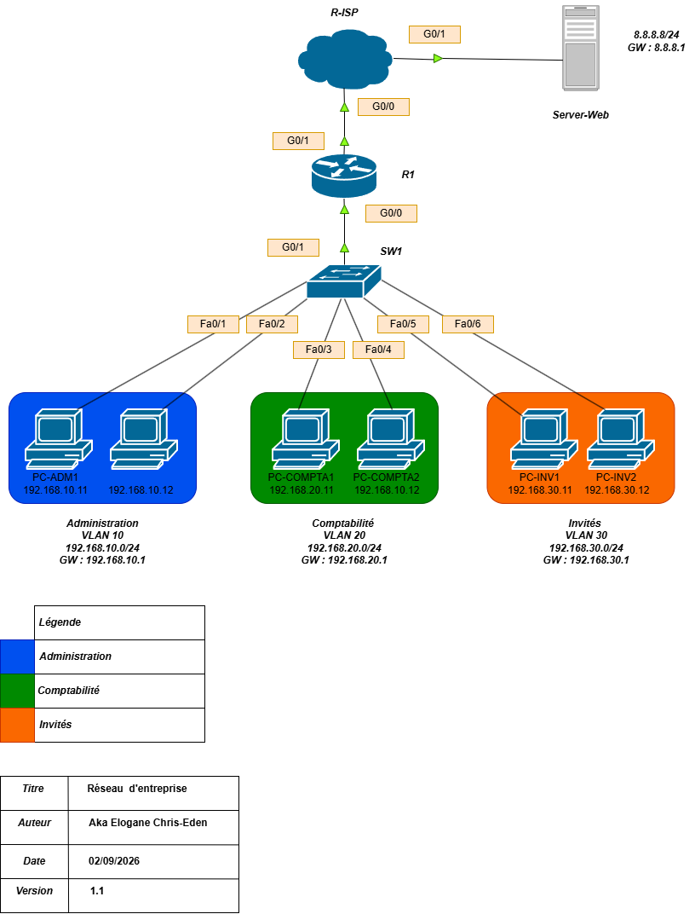

# Réseau d'entreprise segmenté en 3 VLAN (Cisco Packet Tracer)

Conception, configuration et validation d'un réseau d'entreprise simulé sous **Cisco Packet Tracer** : segmentation en VLAN, routage inter-VLAN, DHCP, NAT/PAT, ACL d'isolation et accès d'administration sécurisé en SSH.

- **Auteur** : Aka Elogane Chris-Eden
- **Version** : v1.1
- **Date** : 02/09/2026
- **Outils** : Cisco Packet Tracer, draw.io (diagrams.net)

---

## 1. Objectifs

- Segmenter le réseau en trois VLAN (Administration, Comptabilité, Invités).
- Assurer la communication entre VLAN via un routeur (router-on-a-stick).
- Distribuer automatiquement les adresses IP (DHCP).
- Donner accès à Internet à tous les postes avec une seule adresse publique (PAT).
- Isoler le VLAN Invités des VLAN internes (ACL étendue).
- Sécuriser l'administration du routeur (SSH v2, Telnet désactivé).

## 2. Topologie



```
PC ── SW1 ──(trunk 802.1Q)── R1 (g0/0)
                             R1 (g0/1) ── R-ISP (g0/0)
                                          R-ISP (g0/1) ── Serveur-Web
```

| Équipement | Modèle | Rôle |
|---|---|---|
| SW1 | Switch Cisco 2960 | Commutation, VLAN, trunk |
| R1 | Routeur Cisco 2911 | Routage inter-VLAN, DHCP, NAT/PAT, ACL, SSH |
| R-ISP | Routeur | Simule le fournisseur d'accès Internet |
| Serveur-Web | Server-PT | Serveur de test (8.8.8.8) |
| 6 PC | PC-PT | Postes utilisateurs (2 par VLAN) |

## 3. Plan d'adressage

### VLAN

| VLAN | Nom | Réseau | Passerelle | Plage DHCP | Adresses exclues |
|---|---|---|---|---|---|
| 10 | ADMINISTRATION | 192.168.10.0/24 | 192.168.10.1 | .11 à .254 | .1 à .10 |
| 20 | COMPTABILITE | 192.168.20.0/24 | 192.168.20.1 | .11 à .254 | .1 à .10 |
| 30 | INVITES | 192.168.30.0/24 | 192.168.30.1 | .11 à .254 | .1 à .10 |

### Liens et interfaces

| Équipement | Interface | Adresse / VLAN | Relié à | Rôle |
|---|---|---|---|---|
| SW1 | Fa0/1-2 | VLAN 10 | PC-ADM1/2 | Accès |
| SW1 | Fa0/3-4 | VLAN 20 | PC-COMPTA1/2 | Accès |
| SW1 | Fa0/5-6 | VLAN 30 | PC-INV1/2 | Accès |
| SW1 | Gi0/1 | Trunk (10, 20, 30) | R1 Gi0/0 | Trunk 802.1Q |
| R1 | Gi0/0.10 | 192.168.10.1/24 | VLAN 10 | Passerelle, NAT inside |
| R1 | Gi0/0.20 | 192.168.20.1/24 | VLAN 20 | Passerelle, NAT inside |
| R1 | Gi0/0.30 | 192.168.30.1/24 | VLAN 30 | Passerelle, NAT inside, ACL in |
| R1 | Gi0/1 | 203.0.113.2/30 | R-ISP Gi0/0 | NAT outside |
| R-ISP | Gi0/0 | 203.0.113.1/30 | R1 Gi0/1 | Lien WAN |
| R-ISP | Gi0/1 | 8.8.8.1/24 | Serveur-Web | Réseau « Internet » |
| Serveur-Web | Fa0 | 8.8.8.8/24 (GW 8.8.8.1) | R-ISP Gi0/1 | Serveur de test |

### Postes

| PC | Port SW1 | VLAN | IP (DHCP) |
|---|---|---|---|
| PC-ADM1 | Fa0/1 | 10 | 192.168.10.11 |
| PC-ADM2 | Fa0/2 | 10 | 192.168.10.12 |
| PC-COMPTA1 | Fa0/3 | 20 | 192.168.20.11 |
| PC-COMPTA2 | Fa0/4 | 20 | 192.168.20.12 |
| PC-INV1 | Fa0/5 | 30 | 192.168.30.11 |
| PC-INV2 | Fa0/6 | 30 | 192.168.30.12 |

## 4. Configurations

Les configurations complètes sont dans le dossier [`configs/`](configs/) : [`R1.txt`](configs/R1.txt), [`SW1.txt`](configs/SW1.txt), [`R-ISP.txt`](configs/R-ISP.txt). Les mots de passe sont remplacés par `<mot-de-passe>`.

### Commandes clés

**VLAN et trunk (SW1)**
```
vlan 10
 name ADMINISTRATION
interface range fa0/1-2
 switchport mode access
 switchport access vlan 10
interface gi0/1
 switchport mode trunk
```

**Routage inter-VLAN, router-on-a-stick (R1)**
```
interface g0/0.10
 encapsulation dot1q 10
 ip address 192.168.10.1 255.255.255.0
 ip nat inside
```

**DHCP (R1)**
```
ip dhcp excluded-address 192.168.10.1 192.168.10.10
ip dhcp pool ADM
 network 192.168.10.0 255.255.255.0
 default-router 192.168.10.1
 dns-server 8.8.8.8
```

**NAT/PAT et route par défaut (R1)**
```
access-list 1 permit 192.168.0.0 0.0.255.255
ip nat inside source list 1 interface g0/1 overload
ip route 0.0.0.0 0.0.0.0 203.0.113.1
```

**ACL d'isolation des invités (R1)**
```
ip access-list extended BLOCK-INVITES
 deny ip 192.168.30.0 0.0.0.255 192.168.10.0 0.0.0.255
 deny ip 192.168.30.0 0.0.0.255 192.168.20.0 0.0.0.255
 permit ip any any
interface g0/0.30
 ip access-group BLOCK-INVITES in
```

**SSH (R1)**
```
ip domain-name entreprise.local
crypto key generate rsa modulus 2048
username admin secret <mot-de-passe>
ip ssh version 2
line vty 0 4
 transport input ssh
 login local
```

## 5. Choix techniques

- **Router-on-a-stick** : un seul lien trunk entre SW1 et R1 transporte les trois VLAN, chaque VLAN ayant sa sous-interface et sa passerelle.
- **ACL en entrée sur `g0/0.30`** : une ACL étendue se place au plus près de la source. Le trafic des invités est filtré dès son arrivée sur le routeur.
- **`permit ip any any` en fin d'ACL** : sans cette ligne, le refus implicite final bloquerait aussi l'accès Internet des invités.
- **PAT (`overload`)** : tous les postes internes partagent l'adresse `203.0.113.2`.
- **SSH uniquement** : Telnet transmet les identifiants en clair, il est donc désactivé sur les lignes VTY.

## 6. Tests et résultats

| Test | Résultat attendu | Résultat |
|---|---|---|
| `show vlan brief` sur SW1 | VLAN 10, 20, 30 avec les bons ports | ✅ |
| `show interfaces trunk` sur SW1 | Gi0/1 en trunk, VLAN 10, 20, 30 autorisés | ✅ |
| Attribution DHCP des 6 PC | Adresses `.11` / `.12`, bonne passerelle | ✅ |
| PC-ADM1 → PC-COMPTA1 | Réussi | ✅ |
| PC-INV1 → PC-ADM1 | Bloqué par l'ACL | ✅ |
| PC-INV1 → 8.8.8.8 | Réussi | ✅ |
| PC-ADM1 → 8.8.8.8 | Réussi | ✅ |
| `show ip nat translations` | Traductions vers 203.0.113.2 | ✅ |
| `show access-lists` | Compteurs des lignes `deny` et `permit` en hausse | ✅ |
| SSH vers R1 (PC-ADM1) | Connexion réussie | ✅ |
| Telnet vers R1 | `Connection refused by remote host` | ✅ |

### Captures

| Test | Capture |
|---|---|
| VLAN sur SW1 |  |
| Traductions NAT |  |
| Ping réussi |  |
| Ping bloqué par l'ACL |  |
| SSH accepté, Telnet refusé |  |

## 7. Dépannage (pannes simulées)

Trois pannes ont été provoquées volontairement puis corrigées, selon une méthode couche par couche. Les fiches détaillées (symptôme, diagnostic, cause, correction, vérification) sont dans [DEPANNAGE.md](DEPANNAGE.md).

| # | Panne introduite | Symptôme | Diagnostic clé | Correction |
|---|---|---|---|---|
| 1 | `no encapsulation dot1q 20` sur `g0/0.20` | Les PC de la comptabilité n'ont plus d'adresse DHCP ni d'accès Internet, les autres VLAN fonctionnent | `show running-config interface g0/0.20` : encapsulation absente (l'interface reste up/up) | `encapsulation dot1q 20` |
| 2 | `switchport access vlan 30` sur Fa0/3 | PC-COMPTA1 a Internet mais n'atteint plus l'administration | `ipconfig /renew` : IP en 192.168.30.x ; `show vlan brief` : Fa0/3 dans le VLAN 30 | `switchport access vlan 20` |
| 3 | `no ip nat inside` sur `g0/0.10` | PC-ADM1 joint les autres VLAN mais pas Internet | `show ip nat translations` : aucune traduction pour 192.168.10.x ; `show ip nat statistics` | `ip nat inside` |

**Enseignements :** une interface `up/up` ne garantit pas une configuration correcte ; une panne de VLAN peut être silencieuse (le PC fonctionne mais dans le mauvais réseau, avec les règles de ce réseau) ; le routage interne ne dépend pas du NAT, seul l'accès à l'extérieur en dépend.

## 8. Arborescence du dépôt

```
reseau-entreprise-vlan/
├── README.md
├── DEPANNAGE.md
├── reseau-entreprise-v1.1.pkt
├── schemas/
│   ├── reseau-entreprise-v1.png
│   └── reseau-entreprise-v1.1.png
├── configs/
│   ├── R1.txt
│   ├── SW1.txt
│   └── R-ISP.txt
└── captures/
```

## 9. Évolutions prévues

- Ajout d'un pare-feu (pfSense / FortiGate) et d'une DMZ.
- VPN site-à-site avec une agence distante.
- Serveur Linux (DNS, DHCP) et supervision Zabbix.
- Redondance (HSRP) et automatisation (Python / Ansible).
